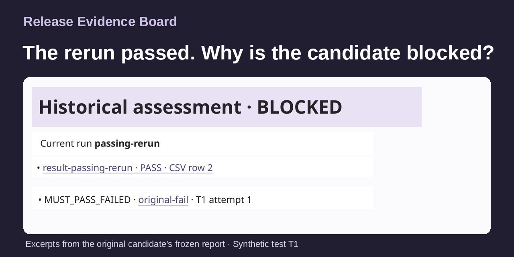

# Release Evidence Board · A release readiness workbench

**The rerun passed. Why is this release candidate still blocked?**

Test T1 checks that the application rejects an unauthorized read. The team marked T1 as a must-pass test. It failed on the first run and passed on the second. Both runs used the same build, test environment, and approved tests. Release Evidence Board keeps both results. The reviewer can trace the block to the failed row in the original CSV.

| Candidate | Evidence | Assessment |
| --- | --- | --- |
| Original · R1 | T1 fails in environment E1. A second run passes. | **BLOCKED**. The earlier failure still applies. |
| Successor · R2 | The team corrects the test environment and records E2. | **BLOCKED**. The required behavior starts as **UNKNOWN** until R2 has its own evidence. |
| Successor · R2 | A fresh run passes T1 in E2. | **SUFFICIENT**. R1 keeps its frozen failure record. |

**[Download both offline reports (.zip)](https://github.com/jpet121/Release-Evidence-Board/raw/refs/heads/main/examples/release-review-reports.zip)**. Extract the files and open `blocked-rerun-report.html` first. Find `original-fail` and `passing-rerun`. Open `corrected-successor-report.html` to see what changed. The released Linux app produced both reports from synthetic test results.

[Run this review yourself](docs/sample-workflow.md) · [Read the test for this rule](internal/board/followup_decision_edges_test.go#L90)

See the corrected candidate in the application

The Windows capture shows the corrected example in the local review screen. A reviewer can use the evidence to advise the release owner. The release owner decides whether to deploy.

## Run it locally

Download the archive for your computer. Check its SHA-256 checksum, extract it, and follow the setup guide to start the local server and sign in. The prebuilt app opens in your browser and needs no Go installation.

[Windows x64 (.zip)](https://github.com/jpet121/Release-Evidence-Board/releases/download/v1.0.0-m1-rc.1/Release-Evidence-Board-M1-Windows.zip) · [Linux x64 (.tar.gz)](https://github.com/jpet121/Release-Evidence-Board/releases/download/v1.0.0-m1-rc.1/Release-Evidence-Board-M1-Linux.tar.gz) · [Checksums](https://github.com/jpet121/Release-Evidence-Board/releases/download/v1.0.0-m1-rc.1/SHA256SUMS.txt) · [Setup and sign-in](docs/run-locally.md)

## What survives a retry, an export, or a restore?

| Operation | What the reviewer keeps |
| --- | --- |
| Preview and commit a CSV | The preview shows the projected assessment. The app saves the results, original CSV, and receipt together. An exact retry returns the original receipt. |
| Freeze a review | The HTML file records the assessment time, approved tests, run IDs, CSV rows, and source digests. It works offline after the live evidence expires. |
| Purge old evidence | A purge preserves shared CSV bytes while a retained candidate still needs them. |
| Restore a backup | The app checks the backup. A reviewer must revalidate the restored store before assessments and exports resume. |

[Design and safeguards](docs/design.md) · [Backup, restore, and recovery](docs/operators.md) · [Tests for these safeguards](evidence/verification.md#functional-and-fault-verification)

## Verification and release status

This M1 prerelease is for synthetic evaluation. The engineering record for application revision `32ba36c` reports 100% measured production line and branch coverage on Windows and Linux, with zero exclusions. It includes recovery tests, browser checks, and targeted mutation tests.

Formal acceptance is still open. The team needs manual accessibility observations, including Safari with VoiceOver, and capacity and recovery results on the specified reference machine. The full mutation campaign is deferred under an M1 exception.

[Verification results and limits](evidence/verification.md) · [Verified Windows and Linux run](https://github.com/jpet121/Release-Evidence-Board/actions/runs/45654657907) · [Prerelease files and notes](https://github.com/jpet121/Release-Evidence-Board/releases/tag/v1.0.0-m1-rc.1)

## Maintain the project

[Build and contribute](CONTRIBUTING.md) · [Report a defect](https://github.com/jpet121/Release-Evidence-Board/issues) · [Report a security issue](SECURITY.md) · [Change log](CHANGELOG.md)
