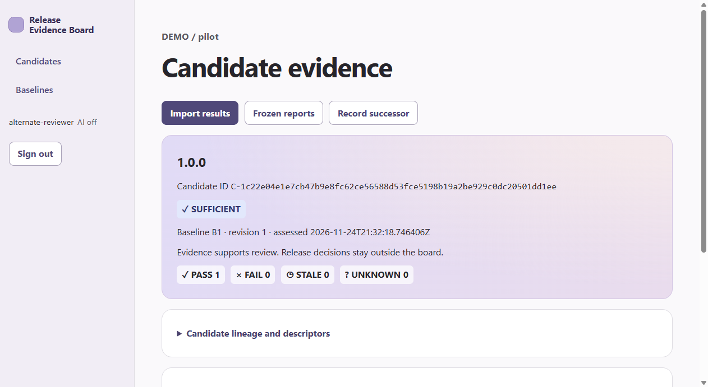

# Release Evidence Board | Test evidence and offline release reports

**Check the test evidence before you make a release decision.**

A passing test can hide a missing run, an old result, or an earlier failure. Release Evidence Board checks results against an approved behavior contract. It keeps the evidence that caused each assessment.

Reviewers approve a baseline. Contributors import test results for an exact candidate. Reviewers can then download a frozen HTML report and read it offline.

**Example.** A required test fails. A later run passes. The candidate stays **BLOCKED** because the earlier definitive failure remains. Record a successor when execution inputs or the approved contract change. Collect new evidence for that successor.



*Actual Windows app at application revision `32ba36c`. Synthetic data. SUFFICIENT describes the candidate's evidence; it does not authorize deployment.*

**[Download](https://github.com/jpet121/Release-Evidence-Board/releases)** · **[Run it](docs/run-locally.md)** · **[Try the sample](docs/sample-workflow.md)** · **[See a report](examples/frozen-report.html)** · **[View test results](evidence/verification.md)**

## What the app does

- Approve a behavior baseline with required tests, pass thresholds, and evidence age limits.
- Identify a candidate by its build, environment, and approved baseline.
- Preview a CSV import. Check the projected assessment before you commit.
- Keep the original CSV, import receipt, ledger sequence, and result records.
- Show PASS, FAIL, STALE, or UNKNOWN for each behavior.
- Freeze an assessment into one HTML file with evidence and reproduction steps.
- Control access by role. Back up, restore, revalidate, and purge evidence with operator procedures.

The Go server runs locally. Your browser shows the interface. The supplied Windows and Linux executables do not need a Go SDK. Optional AI features are off.

## Run it

Download an archive from **Releases**. Extract it. Open a terminal in its `release-evidence-board` folder. Create the `data` directory.

Windows PowerShell:

```powershell
New-Item -ItemType Directory -Force .\data | Out-Null
.\bin\windows-amd64\release-evidence-board.exe init -db .\data\evidence.db -project pilot -product DEMO -actor reviewer
.\bin\windows-amd64\release-evidence-board.exe serve -db .\data\evidence.db -project pilot -product DEMO -listen 127.0.0.1:8080
```

Run `init` only for a new database. Save the password it prints. Open **http://127.0.0.1:8080/login**. Sign in as `reviewer`. If the database already exists, use its original password and skip `init`.

[Windows and Linux instructions](docs/run-locally.md) include checksum checks, source builds, shutdown, and setup errors.

## Keep the evidence useful

The app commits CSV evidence and its receipt in one database transaction. A repeated import returns the original receipt. A purge cannot remove shared CSV bytes while a retained candidate still needs them.

A frozen report records the assessment time and exact evidence. Its status stays historical when live evidence becomes stale. The downloaded report needs no server, script, font service, or network connection.

Backups have a checksum. A restored store needs reviewer revalidation before new assessments and exports resume. [Design and safeguards](docs/design.md) · [Backup and restore](docs/operators.md)

## What the tests show

The unchanged application has **100% measured production line and branch coverage, with zero exclusions**, on Windows and Linux. Go/template measurements are 4,139/4,139 lines and 3,974/3,974 outcomes per target. CSS measurements are 74/74 lines and 6/6 outcomes on each of four recorded clients.

Retained verification includes test suites, race checks, browser journeys, recovery faults, and targeted mutation checks. [Results, source identities, and limits](evidence/verification.md)

This M1 candidate is for synthetic evaluation. Formal acceptance still needs manual accessibility and qualified reference-host observations. Safari and VoiceOver evidence is missing. The full mutation campaign is paused under an explicit M1 exception. Missing checks are not counted as passed.

## Maintain it

[Contribute](CONTRIBUTING.md) · [Report a defect](https://github.com/jpet121/Release-Evidence-Board/issues) · [Security reports](SECURITY.md) · [Change log](CHANGELOG.md)

Source builds use Go 1.27.4. The repository includes the application tests. Behavior fixes need a failing test before the fix. The production coverage requirement remains 100% for lines and branches. Ordinary CI tests do not reproduce the qualified coverage campaign.
